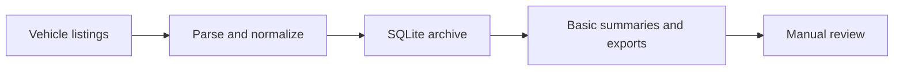

# Automotive Market Intelligence — collect first, decide later

[](https://github.com/dmitriibilecki/automotive-market-intelligence/actions/workflows/checks.yml)

**I wanted to choose a car for my family and understand what was actually available within reach.**

Browsing individual listings gave me fragments of the picture: a price here, a mileage figure there, another tab to remember. I built this project to collect that information in one place and make it easier to look through.

It started with a personal question: what does the market offer, and where do my expectations fit?

## Where the project is now

The current focus is **collecting and organizing listing data**. I have a local archive and review it manually: how many cars of a particular brand appear in the collected sample, what sellers are asking, and how the listings differ.

I have not yet carried out a separate, systematic analysis of that archive. That will be a later stage of the project.

The code already includes basic summaries, comparisons and reports. These are building blocks for exploring the data, rather than a finished market study or a validated car-buying recommendation.

## What the pipeline collects

- Vehicle make, model and year.
- Asking price and mileage.
- Available attributes such as fuel type and transmission.
- Listing identifiers and observation timestamps.

The pipeline parses and normalizes the records, stores them in SQLite, updates repeated observations and exports reports for inspection.



The public code also demonstrates comparisons between similar listings and simple rules for a manual-review shortlist. A low asking price is a reason to investigate, not a buying recommendation.

## Where I want to take it

The next stages are separate from the current collection work:

1. **Explore the archive:** check coverage, missing fields and useful comparisons in a dedicated analysis or dashboard.
2. **Make comparisons more useful:** account for the details that make two cars genuinely comparable, and expand collection coverage where practical.
3. **Support a purchase decision:** combine a family's needs and budget with the available evidence to help decide which cars to inspect, which to skip and what still needs checking.

The goal is to support a better-informed decision about a family car. It is not an automatic buy-or-don't-buy system today.

## Try the public example


The screenshot uses generated data. To create the example on your own computer:

1. Download the repository using **Code → Download ZIP** and extract it.
2. Install Python 3.12 or newer if needed.
3. Open a terminal in the extracted folder and run:

```sh
python demo.py
```

4. Open `output/market.html` in your browser.

The demo runs locally without opening a listing website or connecting to my computer. It creates 240 fictional vehicle records, a SQLite database, a CSV export and a summary report. These numbers do not describe the real market.

## Public code, private archive

This repository contains the collection and reporting code, documentation and fictional examples. My original archive, real-data aggregates, seller information, photographs, browser sessions and local settings remain private.

`export_aggregates.py` provides an optional transformation for a locally supplied database. No real database or export is bundled. The [Tableau brief](docs/TABLEAU_BRIEF.md) describes a dashboard based on the synthetic demo.

## Development and checks

To run the parser, storage and reporting checks:

```sh
python -m pip install -r requirements.txt
python -m unittest discover -s checks -p "check*.py" -v
```

All 13 checks passed for the public release. GitHub Actions runs the checks and demo on each push and pull request.

For a separately configured live run, `main.py` retains the collector. Install Playwright's browser and check the source site's permitted access before running it. The offline demo and tests need no live collection.

## How to read the data

Asking prices are not transaction prices. Simple peer comparisons do not fully account for condition, trim, engine, accident history or seller behavior. Small groups may be unreliable; the current peer-price heuristic does not enforce a minimum group size.

Collection defaults target Warsaw and produce a limited sample, not a representative view of the Polish market. A brand appearing often in this archive does not establish its market share.

`first_seen_at` means the collector's first observation, not the listing's publication date. A missing listing does not prove a sale. Absence tracking requires an explicit full-coverage snapshot; the capped collector does not provide one, so active flags do not establish current inventory.
