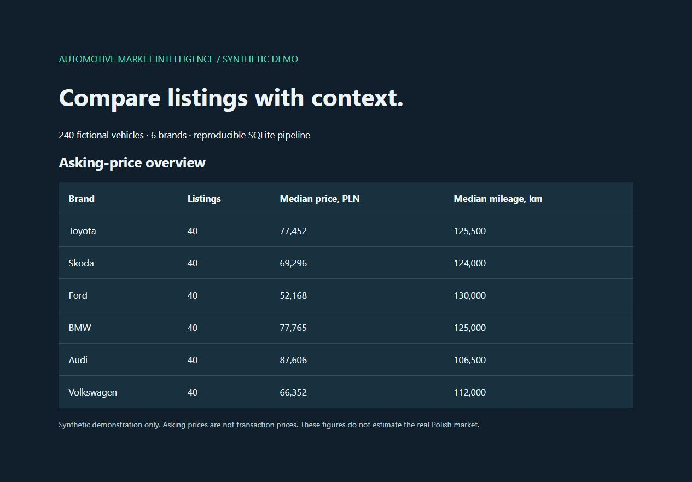
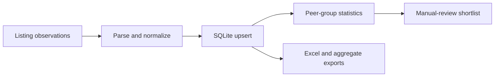

# Automotive Market Intelligence

A Python pipeline for inspecting used-car asking prices: collect structured listing attributes, deduplicate records in SQLite, calculate peer medians and generate operational reports.

The project grew from a personal need to compare vehicle listings consistently. This public edition includes the collection and reporting code plus an offline demonstration using entirely synthetic records. No original listings, seller details, photographs, browser sessions or private logs are redistributed.



## Offline demo

Python 3.12 or newer. The demo uses only the standard library and never opens OLX.

```sh
python demo.py
```

Open `output/market.html`. The run also produces a reproducible SQLite database, `output/brand_summary.csv` for Tableau and a JSON summary. All public demo values are synthetic and are labeled accordingly.

## Public edition and private data

This is a separate public snapshot. The original observation archive, all real-data aggregates, seller information, photographs, browser profiles and local settings remain outside this repository. Only generated demo data and fictional test fixtures are included.

`export_aggregates.py` documents an optional local transformation for a database supplied by its owner; no real database or export is bundled. [Tableau dashboard brief](docs/TABLEAU_BRIEF.md) describes the synthetic demonstration.

To run the existing parser, storage and report checks:

```sh
python -m pip install -r requirements.txt
python -m unittest discover -s checks -p "check*.py" -v
```

Local release validation: all 13 parser, storage and report checks passed, including the conservative absence-tracking guard. The offline demo completed with 240 synthetic records. The included CI workflow has not yet run on GitHub.

## What the code demonstrates

- Structured parsing with a field allowlist.
- Idempotent updates: preserve first-seen time while updating last-seen time.
- SQLite storage and brand-level summaries.
- Peer groups based on brand, model and year.
- Transparent rules for prioritizing listings for manual inspection.
- Explicit missing values, collection limits and blocking detection.



## Read the metrics correctly

Asking prices are not transaction prices. Peer medians do not control for condition, trim, engine, accident history or seller behavior. Small peer groups can produce unreliable comparisons; the current heuristic does not enforce a minimum group size. The score is a rule-based shortlist aid, not a trained valuation or fraud model.

`first_seen_at` measures this collector's observation time, not the listing's publication date. A missing listing does not prove a sale. In this public edition, `mark_missing_inactive` is disabled unless a caller explicitly supplies `complete_snapshot=True` and guarantees full database coverage. The inherited capped collector does not make that guarantee, so it no longer marks unseen records inactive. Active flags consequently do not measure current inventory. A production upgrade should scope absence tracking by search and successful crawl coverage.

The collector's convenience defaults target Warsaw. This is a convenience sample, not a representative estimate of the Polish car market. No price trends, sales conversion or model accuracy are claimed by this release.

## Live collection

The inherited `main.py` remains available for a separately configured live run. Install Playwright's browser first if needed. Check the site's current terms and permitted access before running collection. The demo and automated checks do not require a live site. Never commit the generated raw database or scraped content.

## Authorship

Developed by Dmitrii Bilecki with AI coding assistance. Product framing, data assumptions and limitations are documented so the implementation can be inspected and discussed.
